# ThermoTwinAI-Quantum

**Research prototype for quantum-enhanced time-series forecasting of thermoelectric coefficient of performance (CoP).** The project compares a quantum-readout LSTM and a quantum-augmented NeuralProphet-style network using a small **synthetic multivariate sensor dataset**. It includes optional drift handling, augmentation, predictive intervals and classical-model benchmarking.

> **Scope:** This is an experimental software project, not a validated industrial digital twin. The default training script **generates synthetic observations** each run; results must not be interpreted as measured field performance or evidence of quantum advantage.

## At a glance

| Area | Implementation |
| --- | --- |
| Task | Forecast CoP from windowed CoP, ambient temperature, module current and humidity series |
| Models | `QLSTMModel` and `QProphetModel` (a custom NeuralProphet-style network, **not** the NeuralProphet library model) |
| Quantum component | Four-qubit PennyLane `default.qubit` circuit integrated with PyTorch |
| Additional modules | Sensor fusion, adaptive causal graph attention, optional drift mask, augmentation and MC-dropout uncertainty |
| Evaluation | MAE, RMSE, MAPE, sMAPE, reported R² and correlation; plots and JSON metrics |
| Benchmarks | Vanilla LSTM; optional NeuralProphet baseline; both project quantum models |

## Architecture

```mermaid
flowchart LR
    A["Synthetic CoP and sensor generator"] --> B[("data/synthetic_tftec_cop.csv")]
    B --> C["IQR clipping + scaling + sliding windows"]
    C --> D["Chronological train / test split"]
    D --> E["Optional augmentation and drift mask"]
    E --> F["Sensor fusion"]
    F --> G{"Select model"}
    G --> H["LSTM + temporal attention"]
    G --> I["1D CNN + temporal pooling"]
    H --> J["4-qubit PennyLane layer"]
    I --> J
    J --> K["Causal graph attention + regression head"]
    K --> L["Forecasts / optional MC-dropout intervals"]
    L --> M[("results/metrics.json and plots/")]
```



*Conceptual training/data-flow diagram; branch details differ between the two architectures.* See [detailed architecture notes](docs/architecture.md) for the model-specific paths and evidence limitations.

## Quick start

Requirements: Python 3.10+ is recommended, and the example assumes a virtual environment. The repository currently has **no pinned root dependency lockfile**, so library compatibility may vary by environment.

```bash
git clone https://github.com/Dheeraj1301/TFTEC_QTwin.git
cd TFTEC_QTwin
python -m venv .venv
# Linux/macOS: source .venv/bin/activate
# Windows PowerShell: .venv\Scripts\Activate.ps1
python -m pip install numpy pandas torch pennylane matplotlib scikit-learn pytest
cd ThermoTwinAI-Quantum
python main.py --model both --epochs 10
```

The run generates `data/synthetic_tftec_cop.csv`, trains the chosen architecture(s), prints forecast metrics, and writes results to `results/` and `plots/`. Training with simulated quantum layers can be slow on CPU.

Useful command-line options:

```bash
python main.py --model q_lstm --epochs 10
python main.py --model q_prophet --window 15 --epochs 10
python main.py --use_drift --use_augmentation --use_uq --epochs 10
```

To run the included test (with `pytest` installed):

```bash
python -m pytest tests -q
```

For an optional separate classical-versus-quantum comparison, use `python -m benchmarks.classical_models` from the `ThermoTwinAI-Quantum` folder. The external NeuralProphet baseline is optional and requires its separate package.

## Code map

```text
ThermoTwinAI-Quantum/
├── main.py                 synthetic data generator and training CLI
├── models/                 quantum LSTM and quantum-Prophet-style models
├── utils/                  scaling, fusion, drift, attention, quantum layers, uncertainty
├── hpo/tune_params.py       grid/random search experiment
├── benchmarks/             comparison with classical models
├── evaluation/             regression metrics and plots
├── analysis/               error, feature and circuit analyses
├── data/                   synthetic example series
├── results/                generated metrics and benchmark outputs
└── tests/                  module-level tests
```

## Reported sample results

The committed `results/metrics.json` contains *example run outputs*, not a controlled comparison:

| Model | MAE | RMSE |
| --- | ---: | ---: |
| Quantum LSTM | 0.0909 | 0.0914 |
| Quantum NeuralProphet-style | 0.1298 | 0.1302 |

The stored record reports R² of 0.0 for both. The evaluator currently **clips negative R² to zero and takes absolute correlation**, so those values need careful interpretation. Running `main.py` regenerates synthetic data, and the sample metrics are **not guaranteed to reproduce exactly**.

## Limitations and next validation steps

- Only synthetic CoP data is included. A real industrial time-series dataset and externally held-out test periods are needed to support practical claims.
- The grid/random hyperparameter-search helper uses its supplied *test* split for selection; introduce a separate validation split before reporting unbiased final results.
- Standardize seeds and environment versions; record dataset hashes, multiple independent runs and classical baselines before comparing model performance.
- PennyLane's `default.qubit` is a simulator. No quantum-hardware speedup or operational deployment is demonstrated.

The project is most useful as a **transparent research prototype** for exploring hybrid quantum/classical model architecture, hyperparameter tuning and comparative time-series evaluation.
