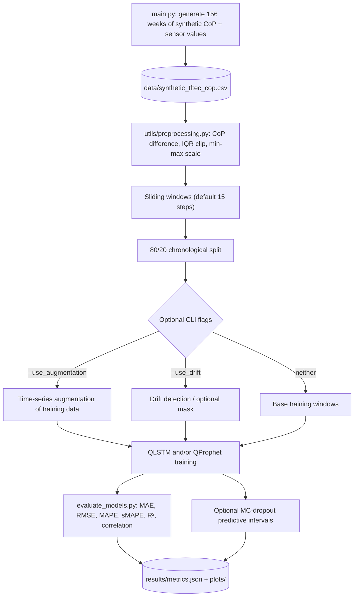
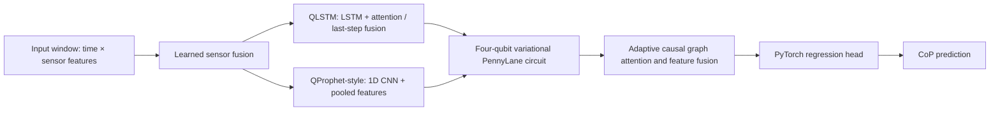

# Architecture — ThermoTwinAI-Quantum

This document describes the **research implementation reflected in the repository**. It intentionally distinguishes the implemented modules from unverified industrial claims.

## Data and training stages

## Model paths

The two models integrate the attention/fusion paths in **different orders**; the diagram summarizes components shared conceptually rather than describing every tensor operation.

## Experiment surfaces

| Location | Purpose |
| --- | --- |
| `main.py` | CLI switches for architecture, window length, learning rate, drift, augmentation and predictive uncertainty |
| `models/quantum_lstm.py` | Temporal model with LSTM, attention and quantum layer |
| `models/quantum_prophet.py` | Custom CNN / quantum / regression architecture |
| `utils/quantum_layers.py` | Four-qubit PennyLane simulator wrapped as a PyTorch module |
| `utils/causal_graph_attention.py` | Sensor relation module |
| `hpo/tune_params.py` | Experimental grid or random search by MAE |
| `benchmarks/classical_models.py` | Vanilla LSTM and optional NeuralProphet comparison |
| `evaluation/evaluate_models.py` | Metrics, optional intervals, JSON output and plots |

## Scientific interpretation

The default dataset is generated, not observed. `results/metrics.json` records example results that can vary between runs; the code does not fix all random seeds at the main entry point. The existing tuning helper evaluates candidate configurations on its test partition, which should be treated as a **validation-design limitation** rather than external benchmark evidence. The reported R² and correlation are transformed by the current evaluator. A robust experimental paper should use fixed train/validation/test time ranges, multiple seeds and matching classical baselines.
